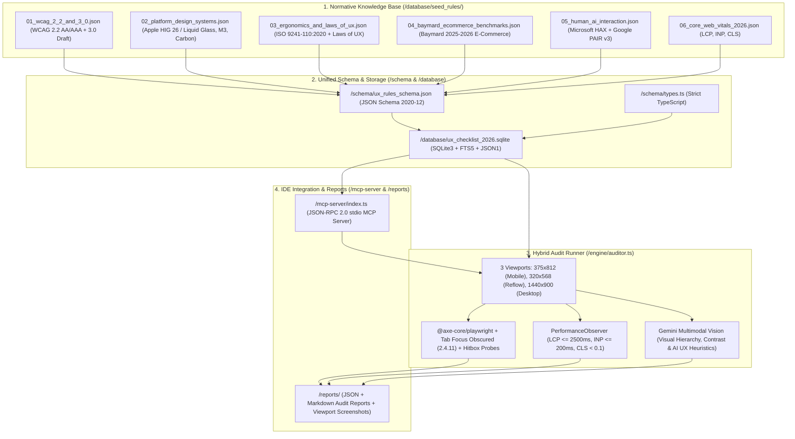

# 2026 UX/UI & Accessibility Audit Database & Hybrid Testing Engine

[](https://nodejs.org/)
[](https://www.typescriptlang.org/)
[](https://www.sqlite.org/)
[](https://www.w3.org/TR/WCAG22/)
[](https://modelcontextprotocol.io/)
[](./LICENSE)

A production-grade, extensible **UX/UI & Accessibility Audit Knowledge Base (2026 Standards)**, **Hybrid Automated Testing Engine** (**Playwright + Axe-core + Core Web Vitals + Gemini Multimodal Vision**), and native **Model Context Protocol (MCP) Server** for **Google Antigravity IDE**, Cursor, and Claude Desktop.

Built to evaluate both live URLs (`https://...` / `http://localhost:*`) and local frontend builds against **11 global UX/UI standard families** (43 normative rules with quantitative thresholds, executable Playwright probes, and Multimodal AI Vision heuristics).

---

## System Architecture



---

## Standards Coverage Matrix (6 Modules / 11 Standard Families / 43 Rules)

| Seed Module | Standard Families (`standard_family`) | Key Audited Requirements & Quantitative Thresholds (`quantitative_threshold`) |
| :--- | :--- | :--- |
| **`01_wcag_2_2_and_3_0.json`** | `WCAG_2_2`, `WCAG_3_0_DRAFT` | • **All 9 New WCAG 2.2 Criteria**: `2.4.11` / `2.4.12` Focus Not Obscured (sticky header/footer bounding-box overlap & `scroll-padding`), `2.4.13` Focus Appearance ($\ge 2\text{px}$ perimeter, contrast change $\ge 3:1$), `2.5.7` Dragging Movements (single-pointer click/tap fallback), `2.5.8` Target Size Minimum ($24 \times 24\text{ CSS px}$ floor), `3.2.6` Consistent Help, `3.3.7` Redundant Entry, `3.3.8` / `3.3.9` Accessible Authentication (clipboard `paste` allowed on passwords, `autocomplete="current-password webauthn"`, Passkey support, zero object-recognition CAPTCHA puzzles).<br>• **Core EAA Criteria**: `1.4.10` Reflow at `320px` without horizontal scroll, `1.4.12` Text Spacing resilience, `1.4.3` Text ($\ge 4.5:1$) & UI ($\ge 3.0:1$) contrast, and WCAG 3.0 `BRONZE` / `SILVER` / `GOLD` scoring tiers. |
| **`02_platform_design_systems.json`** | `APPLE_HIG_26`, `MATERIAL_3`, `IBM_CARBON` | • **Touch & Typography**: $44 \times 44\text{pt}$ hit targets (Apple HIG), $48 \times 48\text{dp}$ targets with $\ge 8\text{px}$ gap (Material 3), body text legibility floor $\ge 17\text{px}$, Dynamic Type scaling up to `200%` without clipping.<br>• **iOS 26 Liquid Glass**: $\ge 4.5:1$ text contrast over translucent blurred (`backdrop-filter: blur`) surfaces, plus `@media (prefers-reduced-transparency: reduce)` & `@media (prefers-reduced-motion: reduce)` adaptation.<br>• **IBM Carbon Completeness**: actionable Empty States with primary CTA, progressive Skeleton Loading states (`loading_skeleton`) instead of blocking spinners, `readonly` vs `disabled` differentiation, and responsive Overflow Menus. |
| **`03_ergonomics_and_laws_of_ux.json`** | `LAWS_OF_UX`, `ISO_9241_110` | • **Cognitive & Ergonomic Laws**: Doherty Threshold ($< 400\text{ms}$ visual feedback), Postel's Law (liberal input normalization), Von Restorff Isolation Effect ($\le 1$ visually dominant Primary CTA per viewport), Gestalt Proximity & Common Region (`label`-to-`input` distance $< 50\%$ of inter-field gap), Miller's Law ($5\text{–}9$ top-level nav items), 4-Digit Chunking, Serial Position Effect, and Zeigarnik / Goal-Gradient progress indicators.<br>• **ISO 9241-110:2020**: explicit mapping to all 7 dialogue principles. |
| **`04_baymard_ecommerce_benchmarks.json`** | `BAYMARD_2026` | • **Checkout & Payments**: Credit Card 4-digit space auto-formatting (`BAYMARD-CHK-01`), Stored Payment "Fake Editing Flow" without forcing prior card deletion (`BAYMARD-CHK-02`).<br>• **Product Page (PDP) & Catalog**: vertically stacked PDP layout instead of horizontal tabs (`BAYMARD-PDP-01`), hidden gallery thumbnail signposting (`+N photos`, `BAYMARD-PDP-02`), Applied Filters overview bar & 8 core search query types (`BAYMARD-NAV-01`).<br>• **Account Self-Service**: 7 core paths in the "My Account" dropdown, 6 on-site order-tracking details without carrier redirect, and explicit `Cancellation Requested` state (`BAYMARD-ACC-01`). |
| **`05_human_ai_interaction.json`** | `MICROSOFT_HAX`, `GOOGLE_PAIR_V3` | • **Microsoft HAX 18 Guidelines & Google PAIR v3**: upfront capability & limitation disclosure (`G1`, `G2`), live token streaming & multi-step reasoning progress, mandatory human-in-the-loop approval before consequential actions, clickable source citations & categorical confidence cues with the `HAX G11` anti-fraud/security non-disclosure exception, cautious adaptation forbidding live list reshuffling (`HAX G14`), granular feedback (`HAX G15`), non-destructive prompt branching, and explicit memory/context reset. |
| **`06_core_web_vitals_2026.json`** | `CORE_WEB_VITALS` | • **Runtime Telemetry**: $\text{LCP} \le 2500\text{ms}$ (`fetchpriority="high"` on above-the-fold hero without `loading="lazy"`), $\text{INP} \le 200\text{ms}$, and $\text{CLS} < 0.1$ across mobile and desktop viewports. |

---

## Quick Start

### Prerequisites
- **Node.js >= 22.5.0** (leverages built-in `node:sqlite` and native TypeScript execution `--experimental-strip-types` with zero native C++ compilation overhead).
- Optional: **Playwright Chromium** (`npx playwright install chromium`) for live headless browser rendering, and a **Google Gemini API Key** (`GEMINI_API_KEY`) for Multimodal Vision screenshot evaluation.

### Installation & CLI Usage

```bash
# 1. Install dependencies (optional for full headless Playwright + Axe browser execution)
npm install
npx playwright install chromium

# 2. Validate all 6 JSON seed modules against JSON Schema (Draft 2020-12)
npm run validate:schema

# 3. Compile and seed the SQLite3 FTS5 database (/database/ux_checklist_2026.sqlite)
npm run seed:db

# 4. Run MCP Server tool self-tests
npm run mcp:test

# 5. Run the Hybrid UX/UI Audit Runner (built-in benchmark fixture or any target URL)
npm run audit -- --self-test
npm run audit -- --url https://example.com
```

---

## Connecting the MCP Server in Antigravity IDE / Cursor / Claude Desktop

Add the server to your MCP configuration (`mcp_config.json`):

```json
{
  "mcpServers": {
    "ux-ui-checklist-2026": {
      "command": "node",
      "args": [
        "--experimental-strip-types",
        "/absolute/path/to/Ux-UI-local-base/mcp-server/index.ts"
      ],
      "env": {
        "GEMINI_API_KEY": "YOUR_GEMINI_API_KEY_HERE",
        "GEMINI_VISION_MODEL": "gemini-2.5-pro"
      }
    }
  }
}
```

### Exposed MCP Tools

1. **`query_ux_rules`** — Filter and full-text search rules by `standard_family`, `category`, `legal_or_business_risk`, `target_state`, or free-text keyword.
2. **`get_rule_by_id`** — Retrieve the complete normative specification for a specific rule ID (e.g., `WCAG-2.4.11`, `BAYMARD-CHK-01`, `HIG-TOUCH-01`, `HAX-G14`), including `quantitative_threshold`, `playwright_check_snippet`, `vision_prompt_heuristic`, and `remediation_guide`.
3. **`generate_component_checklist`** — Generate a curated pre-flight UX/UI checklist and acceptance criteria for a specific component type (`checkout_form`, `ai_chat`, `product_page`, `navigation_header`, `auth_login`, `data_table`).
4. **`run_hybrid_ux_audit`** — Launch a multi-viewport audit (`375x812`, `320x568`, `1440x900`) against any live URL or local dev server and output structured JSON and Markdown reports to `/reports/`.

---

## Repository Structure

```text
├── .github/workflows/ci.yml            # GitHub Actions CI: schema validation, SQLite build & MCP/Auditor tests
├── schema/
│   ├── types.ts                        # Strict TypeScript interfaces & enums (UxAuditRule, AuditReport)
│   ├── ux_rules_schema.json            # JSON Schema (Draft 2020-12) specification
│   └── validate_seeds.ts               # Automated seed validator
├── database/
│   ├── schema.sql                      # SQLite3 + FTS5 relational DDL & sync triggers
│   ├── init_db.ts                      # JSON -> SQLite3 compiler & query layer
│   ├── ux_checklist_2026.sqlite        # Compiled production SQLite3 database
│   └── seed_rules/                     # 6 modular JSON seed files (43 normative rules)
├── engine/
│   └── auditor.ts                      # Hybrid Runner (Playwright + Axe + Web Vitals + Gemini Vision)
├── mcp-server/
│   └── index.ts                        # Native MCP Server (JSON-RPC 2.0 over stdio)
├── reports/                            # Generated JSON/Markdown audit reports & viewport screenshots
├── .env.example                        # Environment variable template
├── CONTRIBUTING.md                     # Guide for authoring and validating new UX/UI rules
└── LICENSE                             # MIT License
```

---

## License

Released under the [MIT License](./LICENSE).
