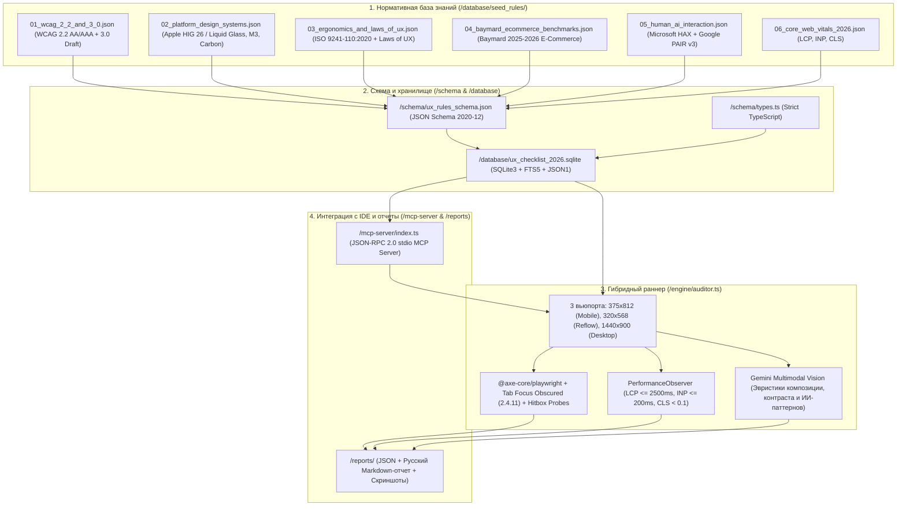

# 2026 UX/UI & Accessibility Audit Database & Hybrid Testing Engine

[](https://nodejs.org/)
[](https://www.typescriptlang.org/)
[](https://www.sqlite.org/)
[](https://www.w3.org/TR/WCAG22/)
[](https://modelcontextprotocol.io/)
[](./LICENSE)

Расширяемая база знаний UX/UI и доступности (стандарты 2026 года), гибридный движок автоматизированного аудита (**Playwright + Axe-core + Core Web Vitals + Gemini Multimodal Vision**) и нативный **MCP-сервер** для **Google Antigravity IDE**, Cursor и Claude Desktop.

Позволяет проверять как живые URL (`https://...` / `http://localhost:*`), так и локальные фронтенд-сборки на соответствие **11 семействам мировых стандартов UX/UI** (43 высокоплотных правила на русском языке с исполняемыми Playwright-пробами и визуальными эвристиками).

---

## Архитектура системы



---

## Охват стандартов (6 модулей / 11 семейств / 43 правила)

| Модуль | Семейства стандартов (`standard_family`) | Ключевые проверяемые требования и пороги (`quantitative_threshold`) |
| :--- | :--- | :--- |
| **`01_wcag_2_2_and_3_0.json`** | `WCAG_2_2`, `WCAG_3_0_DRAFT` | • **9 новых критериев WCAG 2.2**: `2.4.11` / `2.4.12` Focus Not Obscured (защита от перекрытия фокуса sticky-шапками, `scroll-padding`), `2.4.13` Focus Appearance (толщина $\ge 2\text{px}$, контраст $\ge 3:1$), `2.5.7` Dragging Movements (одиночный клик/тап вместо drag-and-drop), `2.5.8` Target Size Minimum ($24 \times 24\text{ CSS px}$), `3.2.6` Consistent Help, `3.3.7` Redundant Entry, `3.3.8` / `3.3.9` Accessible Authentication (разрешение `paste` в паролях, `autocomplete="current-password webauthn"`, Passkeys, отказ от головоломок CAPTCHA).<br>• **Базовые критерии EAA**: `1.4.10` Reflow на `320px` без горизонтального скролла, `1.4.12` Text Spacing, `1.4.3` Контраст текста $\ge 4.5:1$ и UI $\ge 3.0:1$, уровни `BRONZE` / `SILVER` / `GOLD` WCAG 3.0. |
| **`02_platform_design_systems.json`** | `APPLE_HIG_26`, `MATERIAL_3`, `IBM_CARBON` | • **Сенсорная эргономика и типографика**: $44 \times 44\text{pt}$ (Apple HIG), $48 \times 48\text{dp}$ с зазором $\ge 8\text{px}$ (Material 3), базовый кегль текста $\ge 17\text{px}$, масштабирование Dynamic Type до `200%` без обрезания.<br>• **iOS 26 Liquid Glass**: сохранение контраста $\ge 4.5:1$ на полупрозрачных размытых (`backdrop-filter: blur`) поверхностях, поддержка `prefers-reduced-transparency` и `prefers-reduced-motion`.<br>• **IBM Carbon**: информативные Empty States с CTA, скелетоны (`loading_skeleton`) вместо блокирующих спиннеров, разграничение `readonly` и `disabled`, адаптивные Overflow-меню. |
| **`03_ergonomics_and_laws_of_ux.json`** | `LAWS_OF_UX`, `ISO_9241_110` | • **Когнитивные законы UX**: Порог Доэрти ($< 400\text{ мс}$), Закон Постела (либеральный парсинг ввода), Эффект фон Ресторфф ($\le 1$ визуально доминирующий Primary CTA на экран), Законы Гештальта (расстояние от `label` до `input` $< 50\%$ от шага между полями), Закон Миллера ($5\text{–}9$ элементов меню), Чанкинг (группы по 4 цифры), Эффект края, Зейгарник и Градиент цели.<br>• **ISO 9241-110:2020**: привязка каждого правила к 7 принципам диалога. |
| **`04_baymard_ecommerce_benchmarks.json`** | `BAYMARD_2026` | • **Оплата и чекаут**: автоформатирование номера карты по 4 цифры с пробелами (`BAYMARD-CHK-01`), паттерн «Fake Editing Flow» для редактирования сохраненных карт без предварительного удаления (`BAYMARD-CHK-02`).<br>• **Карточка товара (PDP) и каталог**: отказ от горизонтальных табов в пользу вертикального стека (`BAYMARD-PDP-01`), явная индикация скрытых миниатюр галереи (`+N фото`, `BAYMARD-PDP-02`), панель активных фильтров «Applied Filters» и 8 типов поисковых запросов (`BAYMARD-NAV-01`).<br>• **Личный кабинет**: 7 базовых путей в меню «Мой аккаунт», 6 деталей трекинга заказа прямо на сайте и статус `Cancellation Requested` (`BAYMARD-ACC-01`). |
| **`05_human_ai_interaction.json`** | `MICROSOFT_HAX`, `GOOGLE_PAIR_V3` | • **Microsoft HAX 18 Guidelines & Google PAIR v3**: прозрачность возможностей и ограничений ИИ на старте (`G1`, `G2`), видимый стриминг рассуждений и обязательное подтверждение человека (`Human-in-the-Loop`) перед необратимыми действиями, кликабельные источники и категориальная уверенность с исключением безопасности `HAX G11`, запрет перетасовки списков под курсором (`HAX G14`), гранулярный фидбэк (`HAX G15`), ветвление промптов и сброс памяти ИИ. |
| **`06_core_web_vitals_2026.json`** | `CORE_WEB_VITALS` | • **Производительность в реальном времени**: $\text{LCP} \le 2500\text{ мс}$ (`fetchpriority="high"` на герое без `loading="lazy"`), $\text{INP} \le 200\text{ мс}$ и $\text{CLS} < 0.1$ на мобильном и десктопном вьюпортах. |

---

## Быстрый старт

### Требования
- **Node.js >= 22.5.0** (используется встроенный нативный модуль `node:sqlite` и нативная поддержка TypeScript `--experimental-strip-types` без необходимости компиляции C++ аддонов).
- Опционально: **Playwright Chromium** (`npx playwright install chromium`) для запуска реального безголового браузера и **API-ключ Gemini** (`GEMINI_API_KEY`) для мультимодальной визуальной оценки скриншотов.

### Установка и команды

```bash
# 1. Установка зависимостей (опционально для полного браузерного прогона с Playwright и Axe)
npm install
npx playwright install chromium

# 2. Строгая валидация всех 6 JSON-модулей по JSON Schema (Draft 2020-12)
npm run validate:schema

# 3. Компиляция и заполнение SQLite-базы (/database/ux_checklist_2026.sqlite)
npm run seed:db

# 4. Самодиагностика инструментов MCP-сервера
npm run mcp:test

# 5. Запуск гибридного UX/UI аудита (встроенный проверочный стенд или внешний URL)
npm run audit -- --self-test
npm run audit -- --url https://example.com
```

---

## Подключение MCP-сервера в Antigravity IDE / Cursor / Claude Desktop

Добавьте конфигурацию сервера в ваш файл настроек MCP (`mcp_config.json`):

```json
{
  "mcpServers": {
    "ux-ui-checklist-2026": {
      "command": "node",
      "args": [
        "--experimental-strip-types",
        "d:/Projects/Google/Ux_Ui_Checklist/mcp-server/index.ts"
      ],
      "env": {
        "GEMINI_API_KEY": "YOUR_GEMINI_API_KEY_HERE",
        "GEMINI_VISION_MODEL": "gemini-2.5-pro"
      }
    }
  }
}
```

### Доступные MCP-инструменты (Tools)

1. **`query_ux_rules`** — фильтрация и полнотекстовый поиск правил по `standard_family`, `category`, `legal_or_business_risk`, `target_state` или поисковому запросу на русском/английском языке.
2. **`get_rule_by_id`** — получение полной спецификации правила по ID (например, `WCAG-2.4.11`, `BAYMARD-CHK-01`, `HIG-TOUCH-01`, `HAX-G14`), включая `quantitative_threshold`, `playwright_check_snippet`, `vision_prompt_heuristic` и `remediation_guide_ru`.
3. **`generate_component_checklist`** — генерация готового чек-листа приемки для конкретного типа UI-компонента (`checkout_form`, `ai_chat`, `product_page`, `navigation_header`, `auth_login`, `data_table`).
4. **`run_hybrid_ux_audit`** — запуск гибридного аудита страницы по `url` на трех вьюпортах (`375x812`, `320x568`, `1440x900`) с сохранением JSON и Markdown-отчетов в `/reports/`.

---

## Структура репозитория

```text
├── .github/workflows/ci.yml            # GitHub Actions CI: валидация схемы, сборка SQLite и тесты MCP/Auditor
├── schema/
│   ├── types.ts                        # Строгие TypeScript-типы и перечисления (UxAuditRule, AuditReport)
│   ├── ux_rules_schema.json            # JSON Schema (Draft 2020-12)
│   └── validate_seeds.ts               # Валидатор модулей базы знаний
├── database/
│   ├── schema.sql                      # DDL-схема SQLite3 + FTS5 + триггеры синхронизации
│   ├── init_db.ts                      # Компилятор JSON -> SQLite3 и слой запросов
│   ├── ux_checklist_2026.sqlite        # Скомпилированная база знаний SQLite3
│   └── seed_rules/                     # 6 модульных JSON-файлов (43 правила на русском языке)
├── engine/
│   └── auditor.ts                      # Гибридный раннер (Playwright + Axe + Web Vitals + Gemini Vision)
├── mcp-server/
│   └── index.ts                        # Нативный MCP-сервер (JSON-RPC 2.0 over stdio)
├── reports/                            # Генерируемые JSON/Markdown отчеты и скриншоты вьюпортов
├── .env.example                        # Шаблон переменных окружения
├── CONTRIBUTING.md                     # Руководство по добавлению новых правил UX/UI
└── LICENSE                             # Лицензия MIT
```

---

## Лицензия

Проект распространяется под лицензией [MIT](./LICENSE).
